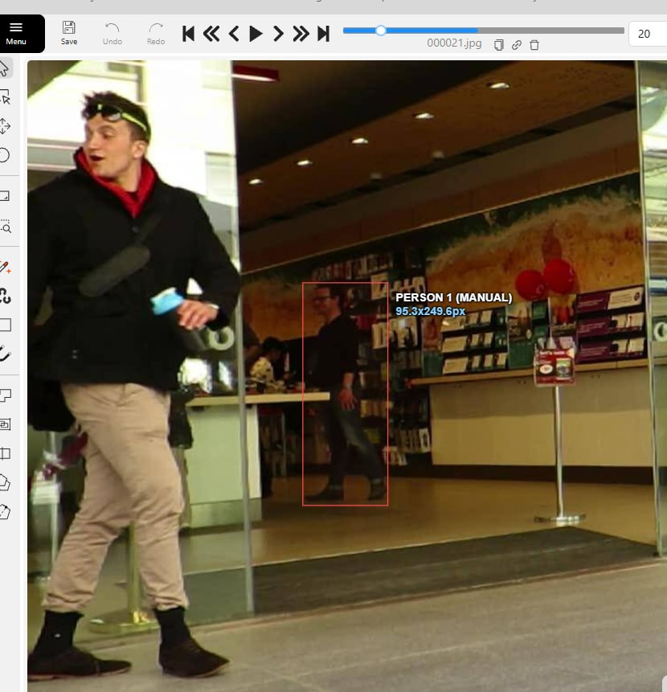
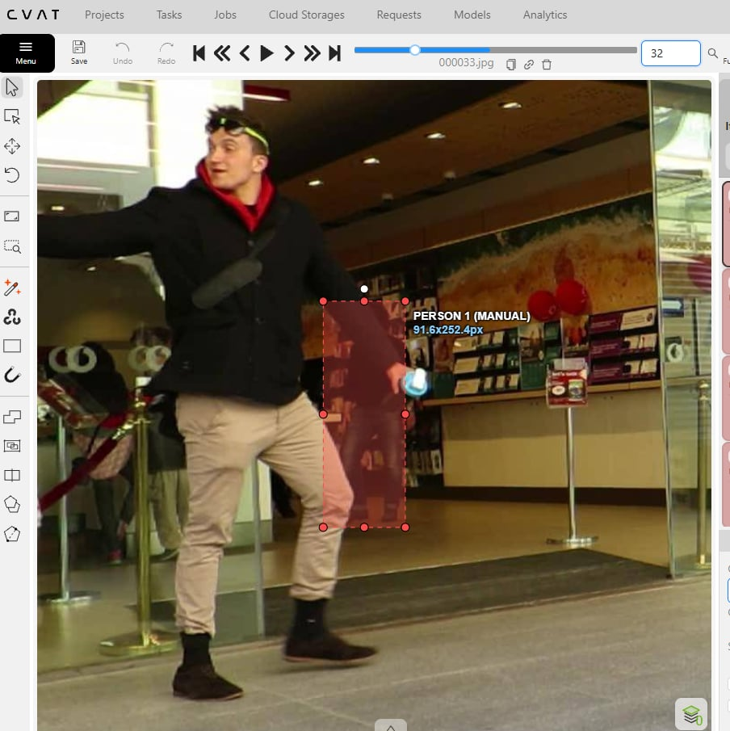
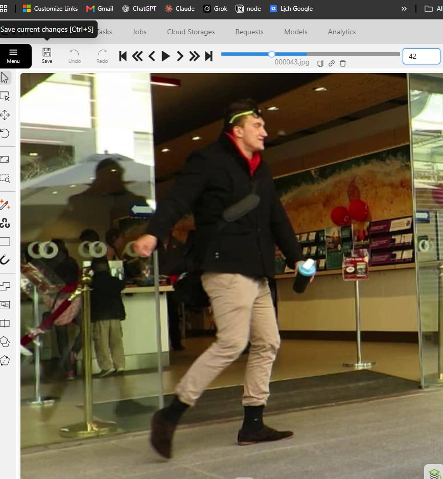
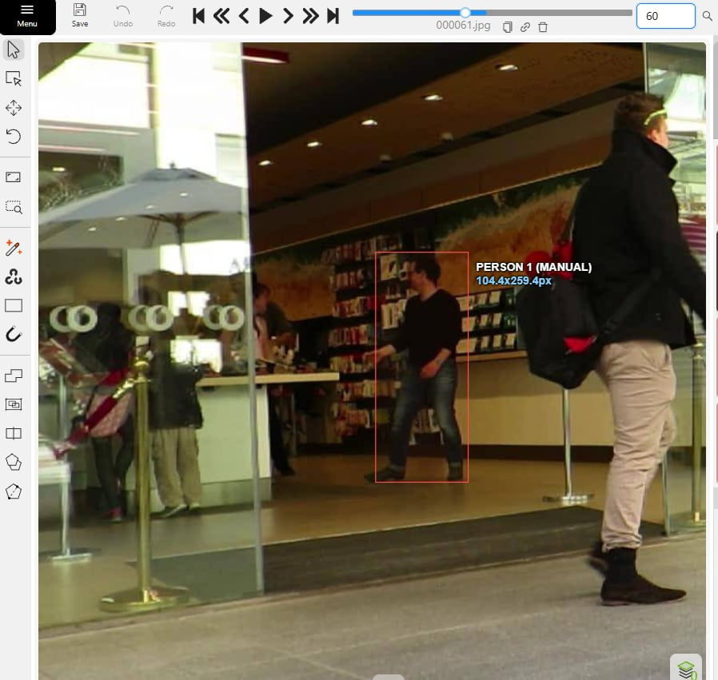

# Báo cáo cá nhân — Đinh Quốc Tiến

## 0. Thông tin học viên

- Họ tên: Đinh Quốc Tiến
- MSSV: 2A202603028
- Mã đề: B
- Email: [dinhquoctien230302@gmail.com](mailto:dinhquoctien230302@gmail.com)
- Link repository: [https://github.com/NEITP/K5-L2A-TienDQ-2A202603028-MOTTracking](https://github.com/NEITP/K5-L2A-TienDQ-2A202603028-MOTTracking)
- Job CVAT local: [`http://localhost:8080/tasks/14/jobs/14`](http://localhost:8080/tasks/14/jobs/14) (chỉ mở được trên máy cá nhân)
- Giờ bắt đầu: 
- Giờ kết thúc:

## 1. Xem trước đoạn video (CP0)

Ghi **trước khi vẽ**, mỗi người một dòng.


| Mã  | Frame xuất hiện | Frame cuối thấy được | Rẽ / dừng / đổi tốc độ ở frame                                                                                          | Bị che / ngoài khung                                                                                           | Ghi chú quan sát CP0                                                                                                               |
| --- | ---------------: | --------------------: | ----------------------------------------------------------------------------------------------------------------------- | -------------------------------------------------------------------------------------------------------------- | ---------------------------------------------------------------------------------------------------------------------------------- |
| P1  | 0               | 149                  | Khoảng 96: đổi hướng, từ đi sang phải ảnh sang đi chậm về phía camera (tâm x giảm nhẹ, box cao dần 281 → 349 px)        | che một phần 26–38; khuất hẳn 39–43; hiện lại 44; rõ trở lại 53                                                | Người mục tiêu CP2; xác nhận trong ảnh CVAT và cờ track                                                                            |
| P2  | 0               | 149                  | Đi sang trái và đến gần camera; tăng tốc biểu kiến khoảng frame 50 (≈ 2 → 4 px/frame) và khoảng 130 (≈ 6 → 10 px/frame) | Không có cờ `occluded`/`outside` trong file xuất                                                               | Người to nhất (box cao 342 → 772 px). Khoảng frame 95–135 đi ngang qua trước P4 và P5, nhiều khả năng là vật che của hai người này |
| P3  | 0               | 149                  | Đi sang trái và đến gần camera; tăng tốc biểu kiến khoảng frame 130 (≈ 2 → 7.6 px/frame)                                | Không có cờ `occluded`/`outside` trong file xuất                                                               | Đang đi vào khung từ mép phải ở frame 0 (box mới rộng 29 px, rộng dần đến ≈ 190 px)                                                |
| P4  | 0               | 146                  | Không rẽ; đi chậm sang phải khoảng 0.36 px/frame từ frame 10                                                            | che một phần 106–109; `outside` 110–134; hiện lại 135 (còn `occluded` 135–139, 143–146); `outside` lại 147–149 | Người nhỏ, ở xa, đi sát P5. Đoạn `outside` 110–134 trùng thời điểm P2 đi ngang qua                                                 |
| P5  | 0               | 104                  | Khoảng 40: dừng (tâm gần như đứng yên từ 40 đến 103, trước đó đi sang phải ≈ 2 px/frame)                                | che một phần 100–104; `outside` từ 105 trở đi                                                                  | Đi sát P4; bị che đúng lúc P2 đi ngang qua và không xuất hiện lại trong đoạn video                                                 |


## 2. Keyframe và thời gian (CP1, CP4)


| Người    | Track CVAT / MOT ID | Số keyframe | Keyframe ở frame CVAT                                                                               | Frame có mặt | KF / 100 frame | Thời gian (phút)                                               | Chỗ khó / ghi chú                                                             |
| -------- | ------------------- | -----------: | --------------------------------------------------------------------------------------------------- | ------------: | --------------: | -------------------------------------------------------------- | ----------------------------------------------------------------------------- |
| P1       | 0 / 1               | 47          | 0, 10–22, 26–27, 30, 44–50, 53–54, 60, 70, 80, 88–95, 100, 110, 112, 119–120, 129–130, 139–140, 149 | 145          | 32.4           | \[điền\]                                                       | Nhiều keyframe quanh đoạn che; đối chiếu box nội suy ở 26–54                  |
| P2       | 1 / 2               | 21          | 0, 10, 20, 30, 40, 50–51, 60, 62, 69–70, 80, 90, 100, 110, 120, 130, 139–140, 145, 149              | 150          | 14.0           | \[điền\]                                                       | Đến sát camera, box cao 342 → 772 px; thêm keyframe dày ở cuối (139–140, 145) |
| P3       | 2 / 3               | 29          | 0, 10, 20, 30, 40, 50–57, 60, 69–70, 79–80, 89–90, 99–100, 109–110, 120, 130, 139–140, 149          | 150          | 19.3           | \[điền\]                                                       | Vào khung từ mép phải, bề ngang box tăng từ 29 px; cụm keyframe 50–57         |
| P4       | 3 / 4               | 25          | 0, 10, 20, 30, 40, 50, 60, 70, 80, 90, 100, 106–107, 135–146                                        | 122          | 20.5           | \[điền\]                                                       | Đoạn `outside` 110–134; kiểm tra lại box khi xuất hiện ở 135                  |
| P5       | 4 / 5               | 16          | 0, 10, 20, 30, 40, 50, 60, 70, 80, 90–93, 100–102                                                   | 105          | 15.2           | \[điền\]                                                       | Track kết thúc hiển thị ở 104; kiểm tra mốc ra khung                          |
| **Tổng** |                     | **138**     |                                                                                                     | **672**      | **20.5**       | ≈ 117 (từ lúc tạo job đến lần lưu cuối, gồm cả thời gian nghỉ) |                                                                               |


Mật độ keyframe toàn bài = 138 / 672 × 100 = **20.5 keyframe / 100 frame có mặt**. P1 có nhiều keyframe nhất (47); keyframe tập trung quanh đoạn che 26–54. Chỉ đếm keyframe ở frame có mặt (`outside=0`); `annotations.xml` còn ghi thêm các keyframe nằm trong đoạn `outside` (tổng thô 216) nhưng các box đó không có mặt trong MOT nên không tính.

Lý do P1 bị che: khoảng cách tâm từ P1 đến bốn người còn lại luôn ≥ 593 px, nên vật che không phải người trong 5 track. Đó là một vật hoặc người ngoài danh sách gán (xác nhận loại vật che trên ảnh frame 32).

## 3. Đoạn bị che (CP2)

Người được chọn: **P1** (CVAT track 0, MOT ID 1).


| Mốc                  | Frame CVAT | Cờ trong CVAT                 |
| -------------------- | ----------: | ----------------------------- |
| Bắt đầu che một phần | 26         | `occluded=1`                  |
| Mất hẳn              | 39         | `outside=1`                   |
| Hiện lại             | 44         | `outside=0`, vẫn `occluded=1` |
| Thấy rõ trở lại      | 53         | `occluded=0`                  |


- Khuất hẳn: 5 frame (39–43) = **0.17 giây** ở 30 fps.
- Quyết định trong file xuất: giữ cùng ID (track CVAT 0 / MOT ID 1).
- Lý do: đoạn `outside` ngắn hơn ngưỡng 60 frame; annotation tiếp tục bằng cùng track, và các ảnh trước/giữa/sau cho thấy chuỗi người mục tiêu liên tục. Số liệu box cũng khớp: trước khi mất (frame 38) box có tâm x ≈ 369.5, kích thước ≈ 90 × 254 px; khi hiện lại (frame 44) tâm x ≈ 401.4, kích thước ≈ 90 × 254 px. Kích thước giữ nguyên, tâm dịch ≈ 32 px, phù hợp với người đang đi tiếp cùng hướng. Hãy xác nhận lại hướng đi và ngoại hình khi mở job trước khi nộp.

Ảnh chụp CVAT có sẵn trong thư mục `images/`:









Nguồn ảnh: MOT17, MOTChallenge (Milan et al., 2016). Ảnh giữa cho thấy box amodal; trạng thái cờ và mốc frame được xác nhận thêm từ `annotations.xml` trong file CVAT xuất.

## 4. Tự review ID (CP3)

Script tự kiểm báo 0 lỗi định dạng và 0 cảnh báo; kết quả đó **không** chứng minh box bám đúng người hay không có lỗi ID.


| Frame  | Mã người | Loại lỗi | Mô tả một câu                                                                                                                                                                                                                     | Phát hiện ở lượt | Đã sửa? |
| ------: | -------- | -------- | --------------------------------------------------------------------------------------------------------------------------------------------------------------------------------------------------------------------------------- | ---------------- | ------- |
| 15–85  | P4       | `drift`  | Box của P4 trôi, không bám đúng người trong đoạn frame 15–85. Số liệu ủng hộ: các keyframe cách 10 frame (20, 30, …, 100) gần như giống hệt nhau, tâm chỉ dịch đều +3.6 px mỗi 10 frame và kích thước giữ nguyên 41.9 × 124.5 px. | Lượt 2           | Chưa    |
| 40–100 | P5       | `drift`  | Tâm box P5 đứng yên (1339.7 → 1341.3 px trong 60 frame) dù trước frame 40 đi ≈ 2 px/frame. Cần xem video xem người có thật sự dừng hay box không còn bám.                                                                         | Lượt 2           | Chưa    |


Tổng hợp sau khi review: `id_switch` 0 · `fragmentation` 0 · `lost` 0 · `merge` 0 · `false_track` 0 · `drift` 1 đã xác nhận (P4), 1 nghi vấn chưa xác nhận (P5) · `flag` 0.

Kiểm tra hình học bổ sung: IoU lớn nhất giữa hai track bất kỳ là 0.158 (P4–P5, frame 0), nên không có dấu hiệu `merge`; mỗi track là một chuỗi liên tục, không có bước nhảy vị trí bất thường nên không có dấu hiệu `id_switch`. Kết quả này không thay cho việc xem video.

Lỗi chỉ lượt 2 mới thấy và lý do:   
- Lỗi drift của P4 ở frame 15–85 được phát hiện trong lượt 2.  
- Lỗi drift của P5 ở frame 40-100 được phát hiện trong lượt 2.

## 5. File xuất và kết quả tự kiểm (CP4)


| Kiểm tra                                    | Kết quả                                                                                                  |
| ------------------------------------------- | -------------------------------------------------------------------------------------------------------- |
| File MOT 1.1                                | `src/exports/TienDQ_mot.zip`                                                                             |
| File CVAT for video 1.1                     | `src/exports/TienDQ_cvat_video.zip`                                                                      |
| Track ID trong MOT                          | 5 (MOT ID 1–5; tương ứng P1–P5)                                                                          |
| Tổng box                                    | 672                                                                                                      |
| Frame `outside` vắng trong MOT              | Đã đối chiếu: 672 box trong MOT trùng đúng 672 box `outside=0` trong XML, sai lệch tọa độ tối đa 0.01 px |
| Job ở trạng thái Completed trong CVAT local | \[xác nhận trạng thái thực tế trong CVAT trước khi nộp\]                                                 |
| Kết quả script                              | **Lỗi: 0 · Cảnh báo: 0**                                                                                 |


Tóm tắt `src/check_submission.py`:

```text
Số frame in theo CVAT (bắt đầu từ 0). Trong gt.txt, frame_id = frame CVAT + 1.

MOT 1.1: TienDQ_mot.zip
Số track ID: 5 | Tổng số box: 672
Track 1: 145 frame; vắng 39–43
Track 2: 150 frame; không có đoạn vắng
Track 3: 150 frame; không có đoạn vắng
Track 4: 122 frame; vắng 110–134
Track 5: 105 frame; không có đoạn vắng

CVAT for video 1.1: TienDQ_cvat_video.zip
Track 0: person, 145 frame thấy, 47 keyframe, 22 frame occluded, 1 lần bật outside
Track 1: person, 150 frame thấy, 21 keyframe
Track 2: person, 150 frame thấy, 29 keyframe
Track 3: person, 122 frame thấy, 25 keyframe, 13 frame occluded, 2 lần bật outside
Track 4: person, 105 frame thấy, 16 keyframe, 1 lần bật outside
Tổng: 138 keyframe / 672 frame có mặt = 20.5 keyframe / 100 frame

Tóm tắt: Lỗi: 0 | Cảnh báo: 0

```

Diễn giải: file có đúng 5 track và 672 box; các khoảng `outside` không có box trong MOT, còn frame `occluded` vẫn thuộc track (cột visibility trong `gt.txt` bằng 0.0 ở đúng 40 box occluded: 22 + 13 + 5). Mật độ toàn bài là 20.5 keyframe trên 100 frame có mặt. Đây là kiểm tra cấu trúc và dấu hiệu hình học, không phải điểm độ chính xác. Script không có ground truth nên không tính MOTA/IDF1 và không xác minh danh tính/người được box bao; cần tự review CP3 trước khi kết luận chất lượng ID.

## 6. Ba câu kết

1. Nếu được gán lại, tôi sẽ đặt keyframe khác ở đâu? Vì sao?

   Tôi sẽ đặt keyframe theo thay đổi chuyển động thay vì cứ 10 frame một lần. Với P4 và P5, các keyframe đều đặn mỗi 10 frame cho ra những box gần như giống nhau, nên box có thể đã không còn bám người (P4 ở 15–85, P5 từ khoảng 40). Tôi sẽ đặt keyframe tại frame 40 của P5 (lúc dừng) và kiểm tra lại từng bước 5 frame ở những đoạn đó. Với P2 và P3 đang tiến sát camera, box thay đổi nhanh và không tuyến tính (tốc độ tâm của P2 nhảy từ ≈ 6 lên ≈ 10 px/frame sau frame 130), nên tôi sẽ đặt keyframe dày hơn ở cuối đoạn thay vì chờ nội suy. Với P1, tôi giữ keyframe ở các mốc che (26, 38, 44, 53) và thêm một keyframe tại frame 96, nơi người đổi hướng.
2. Có đoạn nào chưa chắc giữ ID hay tạo ID mới? Bạn quyết định và ghi chú thế nào?

   Đoạn chưa chắc nhất là P4 xuất hiện lại ở frame 135 sau 25 frame `outside` (110–134), vì lúc đó P4 và P5 đang đi sát nhau và P2 vừa đi ngang qua che cả hai. P5 không xuất hiện lại trong khi P4 xuất hiện lại, nên có khả năng người thấy ở frame 135 là P5. Tôi quyết định giữ nguyên ID 4 cho người xuất hiện lại vì khoảng `outside` ngắn hơn ngưỡng 60 frame, vị trí và kích thước box gần với box cuối của P4 (tâm x ≈ 1318 so với ≈ 1315 trước đó). Ghi chú là cần xem lại ngoại hình hai người này trước khi nộp. Đoạn P1 mất 5 frame (39–43) tôi giữ cùng ID vì box trước và sau có cùng kích thước ≈ 90 × 254 px.
3. Một lỗi ID trong job có thể làm xe tự lái dự đoán sai chuyển động ra sao; lỗi đó tác động MOTA hay IDF1 nhiều hơn? Liên hệ lỗi trong job của bạn.

   Khi ID bị đổi giữa hai người, bộ dự đoán nối quỹ đạo của người này với người kia nên vận tốc và hướng đi bị ước lượng sai: người đứng yên có thể bị tính là đang chạy ngang, hoặc ngược lại. Xe sẽ phanh sai lúc hoặc không phanh. Lỗi đổi ID tác động IDF1 nhiều hơn MOTA, vì MOTA chỉ đếm mỗi lần đổi ID là một lỗi trong tổng số lỗi, còn IDF1 đo mức độ giữ đúng danh tính trên toàn bộ quỹ đạo, nên một lần đổi ID làm cả hai quỹ đạo bị cắt đôi. Trong job của tôi lỗi đã tìm được là `drift` ở P4 (15–85) chứ không phải `id_switch`. Lỗi này làm box lệch khỏi người thật, tức là IoU thấp: nhiều box bị tính là sai vị trí, tăng cả FP và FN, nên tác động MOTA nhiều hơn IDF1. Nguy cơ `id_switch` trong job nằm ở cặp P4 và P5 sau khi P2 đi ngang qua.

## 7. Tài liệu tham khảo và công cụ AI đã dùng

- Milan et al. (2016), MOT17 / MOTChallenge; giấy phép CC BY-NC-SA 3.0.
- CVAT (gán nhãn video, xuất MOT 1.1 và CVAT for video 1.1) và script `src/check_submission.py`.